# Backdrops

Animated backdrops for the Claude desktop app. Install the picker to get every theme with a preview
of each, or install only the themes you like.

<picture>
  <source srcset="assets/picker.avif" type="image/avif">
  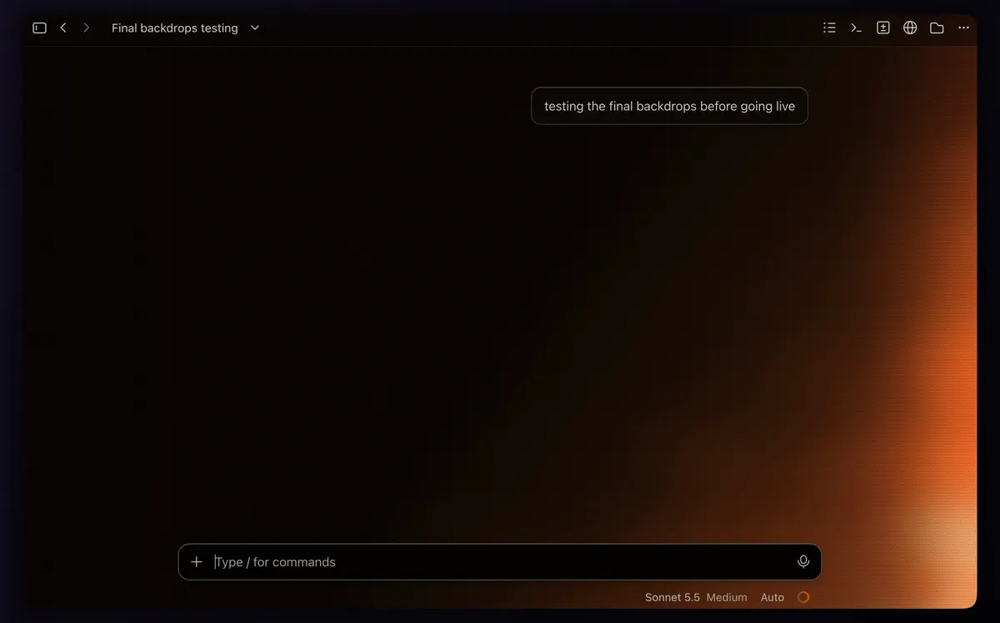
</picture>

<p align="center"><a href="#themes">Themes</a> · <a href="#the-picker">The picker</a> · <a href="#install">Install</a> · <a href="#use">Use</a></p>

## Themes

<p align="center"><a href="#reaching">Reaching</a> · <a href="#magenta-hour">Magenta Hour</a> · <a href="#after-hours">After Hours</a> · <a href="#crossing-hour">Crossing Hour</a> · <a href="#promenade">Promenade</a> · <a href="#coast-road">Coast Road</a> · <a href="#ocean-road">Ocean Road</a> · <a href="#fractal-glass">Fractal Glass</a> · <a href="#ember">Ember</a></p>

### Reaching

Two hands in dots, their forearms traced from Michelangelo's fresco; one wave crosses from arm to arm
and turns the dots to ASCII as it passes. **Artwork by @samdape, used with permission** (the forearms
past the artwork's edges are our extension, see [ARTWORK.md](ARTWORK.md)). The single `reaching`
plugin also has a calmer version for long reading on big screens: `/reaching classic`.

### Magenta Hour

A synthwave Miami dusk: palms, a causeway, the sun going down over a violet bay. Comes with three
original tracks (off until you turn music on).

### After Hours

A synthwave Miami night: the city lit up across the bay, seen from a rooftop.

### Crossing Hour

Tower Bridge at sunset: a cyclist rides out of the sun and across the bridge, a red bus
passes, boats and gulls on the Thames.

### Promenade

The Brooklyn Bridge at dusk: a cyclist rides the promenade toward the sun setting beside
One World Trade Center, cars glinting through the deck, a ferry on the East River.

### Coast Road

Bixby Creek Bridge, Big Sur, at sunset: a cyclist rides north as the sun sets on the sea
inside the arch; fog breathes between the canyon walls, surf, pelicans and a condor.

### Ocean Road

The Atlantic Ocean Road in Norway at dusk: a cyclist rides the long curve across the sea,
shrinking with distance until only his tail light climbs Storseisundet's hump; a car comes
over the top, the coastal express passes, swell breaks on the skerries.

### Fractal Glass

A blue glow drifting behind a pane of fluted glass.

### Ember

A warm glow breathing in the corner of a dark, grainy screen.

*These move: each is the theme's own animated picture, the same file the app draws, with a sample
conversation drawn on top in the app's layout.*

Every theme keeps the chat readable with the sidebar, the right panel or both open, on any window from
a laptop to a 5K monitor: text contrast is at least 7:1 (4.5:1 for secondary and grey text) with both
closed, and 4.5:1 (3:1) with either or both open.

[↑ Back to top](#backdrops)

## The picker

`/backdrops` opens a strip above the prompt: one row of previews, seven to a page, with **None** last.

- **Try one:** click a preview. It shows in this session only, and the strip offers **↵ make default**.
- **Keep it:** press Enter, or click **↵ make default**. It becomes the backdrop for every new session; the strip
  says so and closes.
- **None:** the last preview, for no backdrop.
- **More themes:** turn the page with **‹ ›** next to `/backdrops`, or rest the pointer for a moment on the outer
  edge of the first or last preview. The **← →** keys work too, once you've clicked a preview (the strip only takes
  keys after a click inside it).
- **✕** closes the strip and keeps whatever is showing.

Music has its own commands (below). Each theme, as its live card:

| | | |
|---|---|---|
|  |  |  |
| Reaching | Magenta Hour | After Hours |
|  |  |  |
| Crossing Hour | Promenade | Coast Road |
|  |  |  |
| Ocean Road | Fractal Glass | Ember |

[↑ Back to top](#backdrops)

## Install

Needs an up-to-date Claude desktop app.

**In the app:** **+** → **Plugins** → **Browse plugins** → **Add** → **Add marketplace** →
`neverblinks/backdrops`, then add **Backdrops**.

**Or in Terminal** (the themes still show up in the desktop app):

```
claude plugin install backdrops --marketplace neverblinks/backdrops
```

Open a new session and type `/backdrops`.

<details>
<summary>One theme only, an older Claude Code, removing</summary>

- **One theme only:** use `reaching`, `magenta-hour`, `after-hours`, `crossing-hour`, `promenade`, `coast-road`,
  `ocean-road`, `fractal-glass` or `ember` in place of `backdrops`. Install the picker or single themes, not both:
  only one backdrop shows at a time.
- **Terminal says `--marketplace` is unknown:** your Claude Code is older. Run `claude update`, or inside a Claude
  Code session run `/plugin marketplace add neverblinks/backdrops`, then `/plugin install backdrops@backdrops`.
- **Tested on** Claude Code 2.1.325 (desktop app 5.11492.5). Older versions have no themes. The picture draws in
  the desktop app only; the terminal and editors show the commands but no picture.
- **Remove:** `/plugin uninstall backdrops`.

</details>

[↑ Back to top](#backdrops)

## Use

| Command | What it does |
|---|---|
| `/backdrops` | the picker: a strip of previews; click one to try it, Enter to keep it |
| `/backdrops <name>` | that theme, here and in new sessions (`/backdrops after hours`) |
| `/backdrops <name> session` | that theme in this session only |
| `/backdrops off` | no backdrop |
| `/backdrops music on` | music for the theme showing, quietly (off until you turn it on) |
| `/backdrops music add` | opens the theme's music folder in Finder: drag your tracks in |
| `/backdrops music add <file>` | copies one track in |
| `/reaching`, `/magenta-hour`, `/after-hours`, `/crossing-hour`, `/promenade`, `/coast-road`, `/ocean-road`, `/fractal-glass`, `/ember` | the single themes: turn on, or add `off` |
| `/reaching classic` | Reaching's calmer version (`/reaching clear` goes back) |

Using another backdrop? Run `/backdrops off` (or the theme's own `off`), or uninstall.

[↑ Back to top](#backdrops)

## Your own music

Any theme can play your own music. Put tracks in that theme's folder, for example
`~/.config/backdrops/music/after-hours/`, or run `/backdrops music add` to open it in Finder,
then turn music on with `/backdrops music on`. They play in name order while that theme shows, and stop when you switch theme,
turn music off or close the window. Your tracks replace Magenta Hour's built-in ones for that theme.

- Formats: m4a, mp3, aac, wav, aiff.
- Each track must be **under 4 MB** (about 3.5 minutes at normal quality): the app reads a file
  whole, up to 4 MB.
- Your files stay on your Mac.

[↑ Back to top](#backdrops)

## What it doesn't do

- **No hover or click effects.** The app never passes the pointer to the backdrop.
- **The desktop app only.** Claude Code in a terminal, in VS Code, on the web or on the phone (including a Remote Control session open on an iPhone) draws no backdrops.
- **Not on the start page.** The app themes a session only once it's open.
- **Still when motion is off:** macOS Reduce motion, or the app's background animation setting.

[↑ Back to top](#backdrops)

## Privacy

Pictures and sound, nothing else: no network access, no telemetry, nothing leaves your Mac. The
plugins store only your choices (which theme, music on or off) in the app's own plugin storage,
and read your music only from `~/.config/backdrops/music/`.

[↑ Back to top](#backdrops)

## Contributing

Backdrops is maintained by its author. Bug reports are welcome: open an issue with your app version, your window
size and what you saw. How the repository works: [CONTRIBUTING.md](CONTRIBUTING.md).

[↑ Back to top](#backdrops)

## Licence

- **Code and music:** [MIT](LICENSE). Use it, change it, build on it, at work too.
- **Artwork:** not for sale or redistribution. Reaching's artwork belongs to @samdape.
  See [ARTWORK.md](ARTWORK.md).

[↑ Back to top](#backdrops)
